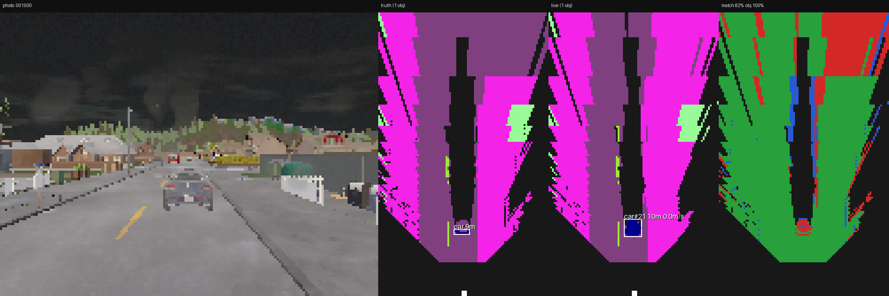
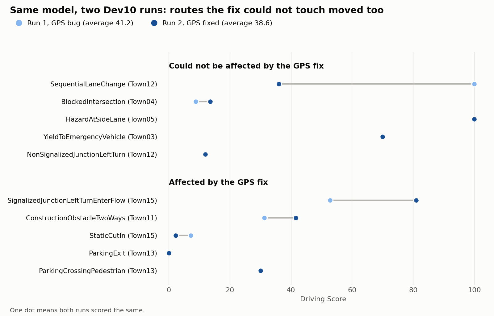

# Learning Autonomous Driving in CARLA

A hands-on build of a self-driving stack in the [CARLA](https://carla.org/) simulator, from a behavior-cloned CNN to a simplified TransFuser scored on a public benchmark. Seven subsystems (imitation learning, perception, localization, classical planning, reinforcement learning, sensor fusion, and benchmarking) were each built and tested on a 6 GB laptop GPU. Each step has its own code, its own pass/fail gate, and a write-up of what broke and why.



*Step 2 on a recorded night drive: camera, simulator truth, the model's own bird's-eye scene, and where the two agree.*

**Latest result:** TransFuser-lite, trained only on Town01, scored **Driving Score 38.6** on the 10-route Bench2Drive Dev10 subset (Route Completion 66.9%, Infraction Penalty 0.70). It drove 3.3 km of Town01 traffic with one collision and 24 lane invasions, then timed out on four of the ten hard scenarios.

## What I learned

- **Good open-loop metrics can hide a broken driver.** TransFuser-lite's first version had low waypoint error but ignored its route target at junctions. Mirroring the target exposed it. A 50 m target, goal channels, and junction sampling fixed it together, and which of them mattered most is unknown ([Step 6](docs/step-6.md)).
- **Data shapes behavior more than I expected.** A perfect expert never makes a mistake, so it never shows how to recover. The student does make mistakes, and each one put it somewhere it had never seen. Recovery had to be added on purpose, with nudges during recording, corrected side-camera labels, and DAgger ([Step 1](docs/step-1.md)).
- **Sensors aren't the car's eyes.** I expected cameras and lidar to feed the driver directly. In Step 2 they feed a separate system that builds a bird's-eye scene, and the driver reads that. Step 6 replaces the hand-built version with one network that learns the conversion ([Step 2](docs/step-2.md)).
- **Classical is a baseline, not what production does.** I expected more ML in Steps 3 and 4, but they turned out almost entirely deterministic, with ML only in perception. Waymo describes [ML across perception, prediction, and planning](https://waymo.com/blog/2021/08/most-experienced-urban-driver/), so the classical stack taught the structure rather than the state of the art ([Step 4](docs/step-4.md)).
- **RL does what you reward, not what you meant.** The policy stopped before turns rather than risk a crash, crawled just above an idle cutoff, and wobbled around the lane center, so the reward had to close each loophole. It felt more like tricking a model into good behavior than writing rules ([Step 5](docs/step-5.md)).
- **The architecture is the easy part.** I expected modern models to be huge and complicated, but TransFuser's core fits in under 300 lines. The real struggle was good data ([Step 6](docs/step-6.md)).
- **Average driving says little, and one run says less.** The model that handled Town01 traffic scored under 14 on four Dev10 routes, and one route went from 100 to 36 with no meaningful code change ([Step 7](docs/step-7.md)).

## Steps

| # | Step | What was built | Result | Write-up |
|---|---|---|---|---|
| 1 | Imitation learning | Branched CNN with radar and DAgger | 0 collisions, 89.8% of a 2.6 km route | [step-1](docs/step-1.md) |
| 2 | Perception | SegNet, learned occupancy, BEV, tracking | Bird's-eye scene from camera and lidar on recorded drives, no simulator truth at inference | [step-2](docs/step-2.md) |
| 3 | Localization | EKF on GNSS, IMU, and wheel speed | 0.98 m RMSE against 4.87 m for raw GNSS, on a synthetic noisy log | [step-3](docs/step-3.md) |
| 4 | Classical pipeline | Prediction, behavior FSM, Frenet planning, five controllers | One 120 s drive with the `hybrid` controller: 462 m, 0 collisions, 0 lane invasions | [step-4](docs/step-4.md) |
| 5 | Reinforcement learning | SAC on a perceived BEV | Finished a 711 m route with 0 collisions, with no traffic and ignoring lights | [step-5](docs/step-5.md) |
| 6 | TransFuser-lite | Camera + lidar fusion to waypoints | 1 collision and 24 lane invasions in 3.3 km with 30 cars | [step-6](docs/step-6.md) |
| 7 | Benchmarking | Agent running on Bench2Drive | Driving Score 38.6 on Dev10 | [step-7](docs/step-7.md) |

The steps are not all scored the same way, so compare results within a step rather than across this table.

## Benchmark results

`models/transfuser.pt` on Bench2Drive Dev10, using CARLA 0.9.15. Raw results are in [`results/`](results/dev10_gpsfix/results.json).



Run 2 in detail:

| Scenario | Town | Driving Score | Outcome |
|---|---|---:|---|
| HazardAtSideLane | 05 | 100.0 | Clean finish |
| SignalizedJunctionLeftTurnEnterFlow | 15 | 81.0 | Finished, left the route lanes |
| YieldToEmergencyVehicle | 03 | 70.0 | Finished, failed to yield |
| ConstructionObstacleTwoWays | 11 | 41.6 | Timed out at 42% of the route |
| SequentialLaneChange | 12 | 36.0 | Finished, two collisions |
| ParkingCrossingPedestrian | 13 | 30.0 | Finished, hit a pedestrian and a vehicle |
| BlockedIntersection | 04 | 13.6 | Timed out, left the route lanes |
| NonSignalizedJunctionLeftTurn | 12 | 12.0 | Timed out at 12% of the route |
| StaticCutIn | 15 | 2.2 | Finished, six collisions |
| ParkingExit | 13 | 0.0 | Never left the parking spot |

**How to read this score**

- Dev10 is a subset, so 38.6 is not comparable to published 220-route Bench2Drive scores or to the official CARLA Leaderboard. The full 220 routes were not run.
- Scores vary between runs. An earlier run of the same model scored 41.2 with a GPS bug on three towns, and fixing the bug did not measurably change the score: routes the bug never touched moved more than the routes it did. One lane-change route went from 100 to 36 with no meaningful code change.
- The model was trained on Low quality images but tested on Epic, because Low quality crashes CARLA 0.9.15 on this setup. The cost of that mismatch was not measured.
- The car drives slowly, with 127 minimum-speed infractions. They did not lower the score here.

## Repository layout

| Path | Contents |
|---|---|
| `expert/` | Step 1: rule-based expert, data recording, imitation learning, DAgger |
| `segmentation/`, `perception/` | Step 2: SegNet, BEV, occupancy, tracking |
| `localization/` | Step 3: EKF and localization evaluation |
| `pipeline/` | Step 4: classical planning and control |
| `rl/` | Step 5: Gymnasium environment, PPO and SAC training |
| `transfuser/` | Step 6: model, training, evaluation, closed-loop drive |
| `bench/` | Step 7: Bench2Drive agent, runner, score table, chart, patch |
| `utils/` | Shared CARLA helpers: connection, routing, sensors, scoring |
| `vendor/carla_agents/` | CARLA's MIT-licensed `agents` module, version 0.9.16 |
| `scripts/` | Connection check, map picker, vehicle spawn, GPU reset |
| `results/` | Benchmark results kept in git |
| `docs/` | One write-up per stage |

Datasets, drive logs, and checkpoints are about 35 GB and are not in git. `data/` and `models/` must be regenerated with the commands in each stage's write-up, so results here cannot be reproduced from a fresh clone without recording and training again.

A few older logs named in the Step 1, 2, 4, and 5 write-ups are no longer on disk, so those numbers are preserved only in the write-ups.

## Setup

Tested with CARLA running on Windows and the Python code in WSL2, on a 6 GB RTX 3060 laptop GPU. The client finds the Windows host automatically, or you can set `CARLA_HOST`.

```bash
python3.12 -m venv .venv
.venv/bin/pip install -r requirements.txt

# With CarlaUE4.exe (0.9.16) running on Windows
.venv/bin/python -m scripts.connect
```

## Running each step

Checkpoints are not in git, so a step that needs another step's model only works after you train that model. Steps can otherwise run in any order. Full commands and options are in each write-up.

| # | Needs CARLA | Needs first | Produces | Commands |
|---|---|---|---|---|
| 1 | Yes | Nothing | `models/radar_dagger.pt` | [step-1](docs/step-1.md#commands) |
| 2 | Yes | Nothing | `models/seg.pt`, `models/occupancy.pt` | [step-2](docs/step-2.md#commands-that-matter) |
| 3 | No for the synthetic test | Nothing | EKF metrics and plot | [step-3](docs/step-3.md#commands-that-matter) |
| 4 | Yes | Step 1 logs for the comparison, Step 2 models for `--perceive` | Classical drive metrics | [step-4](docs/step-4.md#commands) |
| 5 | Yes | `models/seg.pt` for perceived BEV, Step 1 logs for the comparison | SAC or PPO policy | [step-5](docs/step-5.md#commands) |
| 6 | Yes | Nothing | `models/transfuser.pt` | [step-6](docs/step-6.md#run-it) |
| 7 | Yes, 0.9.15 | `models/transfuser.pt` | Driving Score | [below](#running-the-benchmark) |

The shortest path to a driving model is Step 6:

```bash
# Record several runs, keeping one for validation
python -m expert.record --semantic --lidar --gnss --cameras center,left,right --seconds 180

# Train, then drive with 30 traffic cars
python -m transfuser.train --data data/run_A data/run_B --val data/run_C --out models/transfuser.pt
python -m transfuser.drive --model models/transfuser.pt --traffic 30 --spawn-index 42
```

Long GPU runs on WSL can die with a CUDA "unknown error". `--auto-resume` continues training from the last checkpoint, as described in [Step 6](docs/step-6.md#run-it).

### Running the benchmark

The benchmark uses a separate install, because it needs CARLA 0.9.15 and Python 3.10 at most:

1. Install CARLA 0.9.15 and its additional maps to `C:\CARLA_0.9.15`.
2. Clone [Bench2Drive](https://github.com/Thinklab-SJTU/Bench2Drive) at commit `7ec25d1` into `~/workspace/bench`, then run `git apply` with `bench/bench2drive.patch`.
3. Create `~/workspace/bench/.venv` with Python 3.10, then install `bench/requirements.txt`.
4. Copy `PythonAPI/carla/agents` from the CARLA install into `~/workspace/bench/carla_pythonapi/`.

```bash
# run.sh starts CARLA itself, so leave any other CARLA closed
bash bench/run.sh dev10 models/transfuser.pt
~/workspace/bench/.venv/bin/python bench/summary.py data/bench/dev10_transfuser
```

## Known limitations

- Training data comes from Town01 only.
- The model has no training on the benchmark's scenarios, and NoCrash was not run.
- The exact cause of the Low quality crash on CARLA 0.9.15 was not identified.
- Some inputs use simulator truth. Step 1 reads the true traffic light state, and Step 6 places its route targets with the true pose. The Step 7 agent uses GPS and compass instead.
- Dev10 was run twice, so its variation between runs is only roughly known.

## Acknowledgments

TransFuser-lite is a simplified reimplementation of [TransFuser](https://arxiv.org/abs/2205.15997) (Chitta et al.). Evaluation uses [Bench2Drive](https://github.com/Thinklab-SJTU/Bench2Drive), the [CARLA Leaderboard](https://leaderboard.carla.org/), and Scenario Runner.

## License

MIT, see [LICENSE](LICENSE). `vendor/carla_agents/` is CARLA's own code, also under the MIT license.

`bench/bench2drive.patch` modifies Bench2Drive and is not covered by this project's license. Bench2Drive has its own license terms, so check them before reusing the patch.
