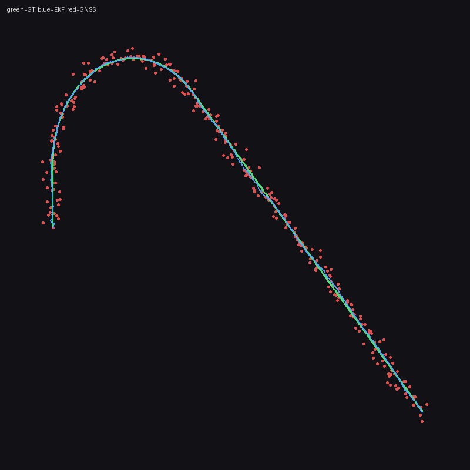

# Step 3 — Sensor Fusion & Localization

Step 3 adds a second product next to perception: **where is the ego car?** Perception (Step 2) still answers “what’s around me” with late fusion on a BEV grid. Localization fuses **noisy GNSS + IMU + wheel speed** with a classical EKF so pose stays smooth.

Gate for this step: under injected GNSS noise, an EKF ego-pose beats raw GPS (lower position RMSE) on the same log. Multi-cam late road fusion and a radar BEV cue are the perception stretch — not a BEVFusion reimplementation.

## Result

On a synthetic log with noisy GPS, the EKF cut position error by a factor of five: 0.98 m RMSE against 4.87 m for raw GNSS, with 0.56° mean yaw error over 600 frames. The gate passed. It has not been confirmed on a re-recorded CARLA run with real sensors, and the checklist below still marks that as open.



*The synthetic test: raw GNSS in red, the true path in green, and the EKF in blue, sitting on top of the true path.*

## What I learned

- **The simulator is more exact than real life.** This step helped me understand the most about how the two differ. We can add some noise, but GPS is never so accurate that I would fully trust it for a precise location. That led me to think about how privileged information in the simulator won't always translate to real life, and to take that into account when building these systems.
- **Privileged information has to be questioned constantly.** Could the model actually know its location during inference if I wasn't feeding that in directly? Where would it get that information? Should it even be included in training if I can't find a real way to provide it? This came up again whenever I added a new data type or input, and [Step 5](step-5.md) shows what happened when a model used to privileged information was given real perception.
- **No training was needed.** I expected ML to be doing more of the work. Here a motion model and noise settings beat raw GPS with nothing learned, and the same idea came back in Step 7 as a small filter in the benchmark agent.
- **Fusion is its own topic.** I learned the trade-offs between the different strategies, and how much there is to it on its own, both in the methods below and in TransFuser itself ([Step 6](step-6.md)).
- **Fusion ≠ concat.** Localization fuses by trust (process vs measurement noise). Perception fuses by geometry on a shared BEV.
- **Late fusion** keeps SegNet / OccupancyNet as separate decisions; the grid is the meeting place.
- **BEVFusion** mixes *features* per cell before detecting — powerful, but not required for this gate.
- **GNSS alone jitters; IMU/odom alone drifts.** Together they make a usable pose.
- **Multi-cam** is the same ground-plane paint with different extrinsics — more road cells on the sides, same OccupancyNet objects.

## What this step has to do

- Record GNSS + IMU (+ GT pose) into `localization.csv` with a shared ENU meter frame.
- Run an EKF: predict with speed + yaw-rate, update with GNSS.
- Prove the filter on a synthetic noisy run (and on CARLA when available).
- Extend BEV road with left/center/right SegNet projection (late / geometric merge).
- Optionally mark forward radar range on the live BEV.

## How the stack is set up

**Localization.**

| Sensor | Role |
|--------|------|
| GNSS | Absolute position, noisy — EKF measurement |
| IMU gyro.z | Yaw rate — EKF predict |
| Wheel speed | Forward speed — EKF predict / soft update |
| Vehicle transform | GT for scoring only |

State: `[e, n, yaw, v]` in local east/north meters (yaw: 0 = north, + toward east). Code: `localization/ekf.py`, sensors in `localization/sensors.py`, record wiring in `expert/record.py`.

Predict uses wheel speed + IMU yaw rate (CARLA `gyro.z` is negated into ENU). Updates: GNSS position, wheel speed, and **IMU compass** (`yaw = π - compass`) so heading does not drift — available at inference, not GT.

**Perception (still late fusion).**

- Road: SegNet → project onto ground plane (`perception/bev.py`). `--multicam` runs left/center/right and OR-merges into one BEV.
- Objects: lidar pillars → OccupancyNet (unchanged).
- Radar: scalar range from `controls.csv` drawn as a cyan cue (`--radar`) — late confirmation, not a new net.

Left/right RGB mounts in `utils/vehicles.py` yaw **±55°** so side coverage is real (wide cams stay yaw 0 for stereo).

**Out of scope.** Soft lift / BEVFusion mid-level feature fusion. SegNet and OccupancyNet stay.

## Commands that matter

```bash
# Record localization (CARLA running)
python -m expert.record --gnss --imu --no-traffic --seconds 60 --cameras center

# Offline EKF gate (no CARLA) — synthetic noisy GPS
python -m localization.eval --synth --out models/loc_preview

# EKF on a recorded run
python -m localization.eval --data data/run_... --out models/loc_preview

# Multi-cam live BEV (+ optional radar cue)
python -m perception.bev --data data/run_... --video --mode live \
  --seg models/seg.pt --occupancy models/occupancy.pt --device cuda \
  --multicam --radar --out models/bev_preview

# Retrain SegNet on yawed left/right (mix with older center runs)
python -m expert.record --semantic --lidar --cameras center,left,right --seconds 180
python -m segmentation.train --data data/run_OLD data/run_NEW --epochs 20 --out models/seg.pt
```

Reference synth gate: `models/loc_preview_synth/metrics.json` (not in git), with the trajectory plot shown at the top of this page (green=GT, blue=EKF, red=GNSS). EKF RMSE 0.98 m against 4.87 m for raw GNSS over 600 frames.

## Gate checklist

- [x] GNSS/IMU plumbing + `localization.csv` schema and `--gnss` / `--imu` on record.
- [x] EKF RMSE beats raw GNSS on synthetic noisy log (`python -m localization.eval --synth`).
- [x] Multi-cam BEV road merge (`--multicam`) with yawed left/right mounts.
- [x] Radar range overlay on live BEV (`--radar`).
- [ ] Optional: re-record a CARLA run with `--gnss --imu` and confirm the same gate on real sensors.

## Verdict

Step 3 localization is classical and **not trained**. Perception nets from Step 2 remain; Step 3 teaches how modalities meet (EKF for pose, projection for multi-cam road) without replacing them with a unified mid-level fusion net.
