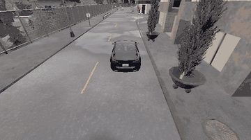
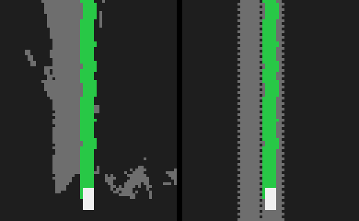

# Step 5 — Reinforcement Learning for Driving

Step 5 leaves expert labels behind. The car gets a **score each tick** (progress,
lane centering, crash penalty) and PPO / SAC update a policy from that score.

DAgger is already done in Step 1 (`expert/dagger.py`, `models/radar_dagger.pt`).
This step is **pure reward**. Privileged GPS/CTE is the cheap learner; `--camera`
is the fair rematch vs Step 1 IL (`models/radar_dagger.pt`): same Town01 route,
same reward/scorecard, policy sees center RGB instead of map CTE. No traffic.

## Result

A SAC policy trained only on reward finished the 711 m fixed Town01 route with 0 collisions and 0 lane invasions, matching the IL baseline on safety and tracking the lane tighter. It took 400k steps, had no traffic, and ignored lights. Full numbers are under "IL vs RL on the fixed route."



*The SAC policy on perceived BEV, on the fixed route with no traffic, at 2.5× speed. This re-run finished 95.1% of the route with 0 collisions and 0 lane invasions.*



*What the policy sees: road perceived from the cameras by SegNet (left) and the map's true road (right). Green is the route and white is the car.*

## What I learned

- **RL is finicky.** The policy found every gap in the reward. It felt less like setting rules and more like tricking the model into behaving the way I wanted.
- **It stopped before turns instead of learning them.** Crashing was so expensive that stopping was the safe choice, so it never practiced the turn. The fix was to make not trying cost as much as failing: stalling is now -20 and ends the episode, the same price as leaving the lane.
- **Every patch created a new loophole.** An idle penalty with a hard cutoff at 3 km/h just taught the car to crawl at slightly above 3 km/h, so it became a ramp up to 10 km/h. Pricing a stall too low let crawling push the off-lane penalty out past the discount horizon.
- **It wobbled to find the center of the lane.** Centering paid, so weaving back and forth around the line scored well. That took a deadzone around the center, jerk penalties, extra cost for steering when already centered, and a bonus for holding steady.
- **Watching training helped.** The car drives in the simulator while it trains, so failure states were easy to see as they happened.
- **The numbers don't show everything.** Reading them is always vague. They're good for getting a sense of a problem at scale, but they can't reliably catch every problem or say what it is. When the car was swerving, the numbers might have looked fine in aggregate, but the movement would have been awful on a real road. You need both qualitative and quantitative measures.
- **Training on privileged information can hurt at inference.** The policy got used to true BEV, so giving it our perceived BEV with no retraining dropped it from 40 of 40 turns to 37 of 40. Providing information in training can hurt if the model doesn't get the same quality during inference, so that difference needs constant thought whenever a new input is added.

RL has real potential and I found it interesting, but it changed how I think about it: the reward is the real program, and the policy will run it literally.

## Why IL plateaus

The expert only shows states it visits. A cloned policy drifts a little, sees a
state the expert never labeled, drifts more. DAgger patches that by labeling
those failure states. RL skips the expert: the reward is defined everywhere the
car can go.

## Architecture

```
CARLA tick ──► GPS obs [cte, heading, speed, lane offset]
            or camera obs {image 4×84×84 grayscale, vec [speed + command]}
            or BEV obs    {image 2×80×64 road (SegNet or map) + route, same vec}
                    │
              PPO or SAC
                    │
              steer + throttle   (or steer only with --speed-control)
                    │
              reward always from the map (progress − |cte| − collision − jerk)
```

Same env and reward for both algorithms. GPS vs camera is the observation
change; PPO vs SAC is how they learn. Do not `--resume` a GPS zip into `--camera`.

**BEV (`--bev`, `rl/bev_obs.py`).** Roach-style input: drivable road and the
planned route, ego-centric, 0.5 m cells, 36 m ahead / 4 m behind / ±16 m
sideways. Still trained purely on reward — only the observation changes.

- Road channel, default: SegNet on center/left/right RGB, projected with
  `perception.bev.fill_ground_multi` (`--seg`, default `models/seg.pt`).
  Needs rendering (~30 env steps/s). `info` carries `bev_road_precision` /
  `bev_road_recall` against the map road.
- `--bev-source map`: map-truth road (privileged). No camera, so
  `--no-render` works (~270 env steps/s). Good for fast training.
- Route channel: always the planner route placed with the true pose, so the
  BEV agent is not yet sensors-only (next: place it with Step 3 EKF pose).

Map-trained policy, swapped to SegNet road with no retraining: 37/40 seeded
turns (left 0.84, right 1.00) vs 40/40 on map road. Perceived road vs map:
precision ~0.87, recall ~0.66.

**Steer-only (`--speed-control`).** Action is just steer; a P controller holds
the waypoint follower's 18 / 14 km/h profile (turn speed with the turning flag).
No expert labels involved, but note it in comparisons vs agents that drive
their own throttle.

**Traffic (`--lights`, `--npc-vehicles N`, `--walkers N`).** Needs `--bev`;
turns on `--speed-setpoint` (action = steer + target speed 0–25 km/h, P
controller on the pedals) so the agent can stop. The BEV gains three channels
(5 total): other cars, pedestrians, and stop lines of red/yellow lights — true
actor boxes for now; lidar OccupancyNet objects are the perceived follow-up.
Light state is sim truth (no light detector yet).

Reward (Roach-style): hazards on the route ahead set a speed cap — red light
(ramps to 0 at the stop line), car in lane (4 m standstill gap), pedestrian in
the path (5 m) — and `r_speed` peaks at the cap, so waiting at a red pays like
cruising. Idle/stall penalties don't apply while the cap is ~0. Crossing a red
stop line: −20 and the episode ends (`ends/rate_red_light`). Light cycles are
shortened server-wide (red 6 s / yellow 2 s / green 8 s).

Train in stages, resuming each from the last (shapes stay the same):

```bash
python -m rl.train --algo sac --bev --bev-source map --lights --sde 20 --no-render \
  --timesteps 300000 --out models/rl_sac_traffic_lights
python -m rl.train --algo sac --bev --bev-source map --lights --npc-vehicles 30 --no-render \
  --resume models/rl_sac_traffic_lights/best_model.zip --fresh-replay --timesteps 300000 --out models/rl_sac_traffic_cars
python -m rl.train --algo sac --bev --bev-source map --lights --npc-vehicles 30 --walkers 40 --no-render \
  --resume models/rl_sac_traffic_cars/best_model.zip --fresh-replay --timesteps 300000 --out models/rl_sac_traffic_all
```

On a hot laptop GPU (CARLA + SAC on one card) CUDA can die with "unknown
error" after about an hour. `--auto-resume` picks up the newest checkpoint in
`--out` (checkpoints every `--checkpoint-every`, default 10k) and treats
`--timesteps` as the total, so a shell loop restarts it until it finishes.
Crashed runs restart with an empty replay buffer.

```bash
until python -m rl.train --algo sac --bev --bev-source map --lights --sde 20 --no-render \
  --timesteps 300000 --out models/rl_sac_traffic_lights --auto-resume; do sleep 30; done
```

Turn diagnostics: `turns/clear_rate_*`, `turns/miss_*` and `ends/rate_*` in
TensorBoard; `python -m rl.eval_turns` for a noise-free, seeded turn test.
Eval scripts detect BEV / steer-only from the checkpoint.

## Env contract

| | |
|---|---|
| Observation | GPS: `cte_m`, `heading_err_deg/180`, `speed_kmh/50`, `lane_offset_frac`. Camera: cropped grayscale 84×84 stack-4 + speed + turn command. |
| Action | `steer ∈ [-1, 1]`, `throttle ∈ [0, 1]`, brake = 0 |
| Done | collision, `\|cte\| > 2.5 m`, ~95% route, or max steps (30 s train) |
| Traffic | none by default; `--lights`, `--npc-vehicles`, and `--walkers` add it |
| Starts | GPS train: ~70% near turns. Camera train: random origin; 85% approach a left/right/straight 18–40 m out (command = ahead), turn episodes cap ~40 s. Eval always spawn 0. |

Reward (see `rl/rewards.py`): progress, CTE (deadzone 0.2 m), heading, collision,
off-lane (−20 when CTE passes 2.5 m; progress/speed only pay within 1 m of the line),
stall (−20 and episode ends if under 3 m of progress in 5 s), an idle penalty that
ramps to 0 at 10 km/h,
jerk, extra `|steer|` when already centered, plus a **steady bonus** for small
CTE + heading + steer. Env deadbands tiny steer on straights; steer is otherwise
raw (smoothness comes from the jerk/flip penalties). `--steer-smooth` restores
the old EMA filter for checkpoints trained with it.

## Gates

1. **Smoke** — `python -m rl.train --algo ppo --timesteps 2000` steps without
   crashing (CARLA up). Same for `--algo sac`.
2. **Checkpoints** — each `--out` folder holds `best_model.zip`, such as
   `models/rl_sac_bev_perc/`.
3. **Scored eval** — `python -m rl.eval_drive` writes `drive_metrics.json` with
   the Step 1 fields (`collisions/km`, invasions, route %, speed, CTE).
4. **Milestone** — a reward-only agent matches the IL baseline on a fixed Town01
   route. See "IL vs RL on the fixed route" below.

## Commands

```bash
# smoke: prove env steps (watch in UE4; add --no-render for fast ticks)
python -m rl.train --algo ppo --timesteps 2000 --map Town01
python -m rl.train --algo sac --timesteps 2000 --map Town01
python -m rl.train --algo sac --timesteps 2000 --map Town01 --no-render

# starter runs (same timesteps for a fair compare)
python -m rl.train --algo ppo --timesteps 100000 --out models/rl_ppo
python -m rl.train --algo sac --timesteps 100000 --out models/rl_sac

# camera policy vs IL (fresh run, not a GPS or old-RGB resume; needs the renderer)
python -m rl.train --algo sac --camera --timesteps 200000 --out models/rl_sac_cam2

# continue from a smoke / prior run (--timesteps is extra steps)
python -m rl.train --algo sac --timesteps 100000 \
  --resume models/rl_sac/best_model.zip --out models/rl_sac
python -m rl.train --algo ppo --timesteps 100000 \
  --resume models/rl_ppo/best_model.zip --out models/rl_ppo

# TensorBoard
tensorboard --logdir models/rl_ppo

# scored eval (same fields as Step 1)
python -m rl.eval_drive --model models/rl_ppo/best_model.zip --algo ppo --seconds 120
python -m rl.eval_drive --model models/rl_sac/best_model.zip --algo sac --seconds 120
# watch at realtime (default). --slow 2 = half speed, --slow 0 = as fast as the sim
python -m rl.eval_drive --model models/rl_sac/best_model.zip --algo sac --seconds 180
python -m rl.eval_drive --model models/rl_sac_cam/best_model.zip --algo sac --camera --seconds 180

# scorecard: GPS-RL vs camera-RL vs Step 1 IL
python -m rl.compare \
  --gps data/rl_drive_sac_<stamp>/drive_metrics.json \
  --camera data/rl_drive_sac_<stamp>/drive_metrics.json \
  --il data/drive_log_20261009_164441/drive_metrics.json
```

CARLA must be running. On WSL set `CARLA_HOST` (or `--host`) to the Windows IP.

## IL vs RL on the fixed route

Town01, spawn 0 → spawn 70 (711 m), no NPC traffic, done at 95% of the route.
IL: `python -m expert.drive --model models/radar_dagger.pt --fixed-route --no-traffic --seconds 480`
(`data/il_fixed_route_radar_dagger`). RL: `python -m rl.eval_drive --model
models/rl_sac_bev_perc/best_model.zip --algo sac` (`data/rl_drive_sac_20261026_*`).

| | IL `radar_dagger.pt` | RL `rl_sac_bev_perc` |
|---|---|---|
| Route | 95.1% (done) | 95.1% (done) |
| Collisions / invasions | 0 / 0 | 0 / 0 |
| \|CTE\| p50 / p90 | 0.15 / 0.38 m | 0.09–0.14 / 0.28–0.31 m |
| Time to finish | 260 s (127 s stopped at reds) | ~164 s |
| Speed while moving | 18.3 km/h | 14.9 km/h |

RL matches IL on safety and completion and tracks the lane tighter. Not
like-for-like on lights: IL obeys them (sim light state as input), the RL
lane-keeper ignores them. Disclose: RL road channel is SegNet (perceived), route
channel uses true pose, speed is a P controller on the follower profile. One run
each; a 240 s IL run that timed out at 86.6% had 1 invasion.

### Sample efficiency

| | IL `radar_dagger.pt` | RL `rl_sac_bev_perc` |
|---|---|---|
| Driving used | ~720 s (600 s expert + 120 s DAgger), ~14.4k frames | 400k steps, ~20,000 s |
| Labels | every frame | none (reward only) |
| First clean fixed-route run | — | 120k steps map BEV; 350k total on perceived BEV |

The IL figure leaves out the turn and lead-car clips, so its real total is higher.

Checkpoint sweep on the same route (`data/rl_sweep/`, one deterministic run each,
240 s cap; map checkpoints scored on map BEV, fine-tune on perceived):

| Steps | Route % | Col | Inv | \|CTE\| p90 |
|---|---|---|---|---|
| 30k map | 7.6 | 1 | 2 | 0.47 |
| 60k map | 86.9 | 1 | 0 | 0.24 |
| 90k map | 95.1 | 0 | 1 | 0.37 |
| 120k map | 95.1 | 0 | 0 | 0.41 |
| 150k map | 95.1 | 0 | 0 | 0.41 |
| 180k map | 95.1 | 0 | 8 | 0.25 |
| 210k map | 95.1 | 0 | 6 | 0.38 |
| 240k map | 95.1 | 0 | 0 | 0.39 |
| 270k map | 95.1 | 0 | 2 | 0.39 |
| 300k map | 95.1 | 0 | 0 | 0.31 |
| 310k perc | 95.1 | 0 | 1 | 0.35 |
| 320k perc | 95.1 | 0 | 4 | 0.21 |
| 330k perc | 37.6 | 1 | 1 | 0.20 |
| 340k perc | 95.1 | 0 | 2 | 0.21 |
| 350k–400k perc | 95.1 | 0 | 0 | 0.19–0.30 |

Completion is solved early (90k); invasions are noisy until late in the
perceived fine-tune, where six checkpoints in a row are clean.

## Status

Built: Gymnasium lane-keep env, shared reward, PPO and SAC CLIs, scored eval,
`--camera` for the IL rematch, `--bev` (map-truth or perceived SegNet road) with
optional `--speed-control`, and traffic through `--lights`, `--npc-vehicles`, and
`--walkers`.

## Package map

| Path | Role |
|------|------|
| `rl/env.py` | `CarlaLaneKeepEnv` — connect, spawn, tick, obs |
| `rl/bev_obs.py` | Map-truth BEV raster (road + route) for `--bev` |
| `rl/eval_turns.py` | Seeded, noise-free turn clear rate per checkpoint |
| `rl/rewards.py` | Progress / CTE / collision / comfort |
| `rl/train.py` | `python -m rl.train --algo ppo\|sac` |
| `rl/eval_drive.py` | Scored Town01 drive → `drive_metrics.json` |
| `rl/compare.py` | GPS-RL vs camera-RL vs IL scorecard |
